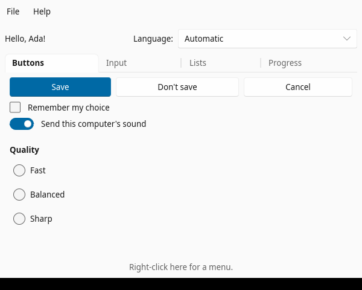
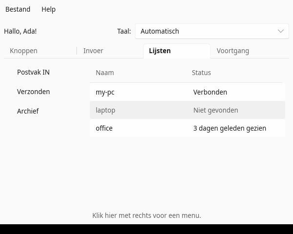
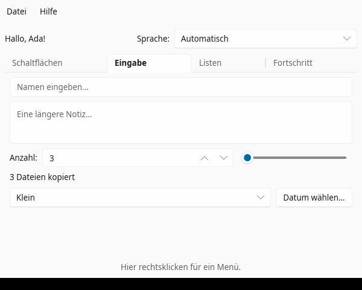

# po-bundle

[](https://crates.io/crates/po-bundle)
[](https://docs.rs/po-bundle)

**Gettext `.po` translations baked into your binary — for Rust code and Slint UIs alike.**

Slint can already translate the strings in `.slint` files (`@tr`) from bundled
`.po` files. But in most apps a good part of the text lives in Rust: status
messages, notifications, tray menus, window titles, list items, errors.
po-bundle gives those the same treatment, from the **same `.po` files**, and
keeps the files up to date as your code changes.

| English | Nederlands | Deutsch |
|---|---|---|
|  |  |  |

*The example in [`examples/hello-slint`](examples/hello-slint): menus, tabs,
buttons, check boxes, switches, radio buttons, text fields with placeholders,
spin box, slider, combo boxes, a list, a table with rows from Rust, a popup,
a context menu and plural forms. Switch the language at the top right and
everything follows at once.*

## What you get

- **One file per language**, in the layout Slint already uses:
  `translations/<lang>/LC_MESSAGES/<crate>.po`. Translators work with the
  tools they know: Poedit, Lokalize, Weblate, Crowdin …
- **`tr!` for Rust**, with English source text, like gettext and Slint's
  `@tr`:
  ```rust
  tr!("Share this screen")                       // &'static str
  tr!("Seen as “{name}”", name = host)           // named placeholders
  tr!("menu" => "Open")                          // a context, Slint's syntax
  ```
- **Never an empty label.** A missing translation shows the English text.
- **The OS language by default**, or the user's choice:
  `po_bundle::set_language(None)` / `set_language(Some("nl"))`. With the
  `slint` feature this also switches Slint's `@tr` texts.
- **A callback on every switch** (`po_bundle::on_change`), to set the texts
  you handed to the UI from Rust again.
- **Nothing to load or install at run time.** `build.rs` turns the `.po`
  files into static tables; a lookup is a binary search.
- **`po-bundle update`** collects every `tr!(…)` in your Rust code and every
  `@tr(…)` in your `.slint` files, writes a `.pot` template and updates every
  `.po` file: new strings are added, strings you removed become obsolete
  (`#~`, so the translation can come back), translations are kept.
- **Slint's own widgets translated too.** `OK`, `Cancel`, `Close` on a
  `StandardButton`, the Cut/Copy/Paste menu of a `LineEdit`, the date and time
  pickers: `po-bundle update --slint` adds those strings, with Dutch and
  German already filled in.
- **`po-bundle check`** fails when anything is untranslated, for CI.

## Quick start

`Cargo.toml`:

```toml
[dependencies]
po-bundle = { version = "0.1", features = ["slint"] } # "slint" only for Slint apps

[build-dependencies]
po-bundle = "0.1"
```

`build.rs`:

```rust
fn main() {
    po_bundle::build::compile("translations");

    // Slint apps: the same folder for the .slint texts.
    let config = slint_build::CompilerConfiguration::new().with_bundled_translations("translations");
    slint_build::compile_with_config("ui/app.slint", config).unwrap();
}
```

`main.rs`:

```rust
use po_bundle::tr;

po_bundle::include_translations!(); // once, at the crate root

fn main() {
    po_bundle::set_language(None); // follow the OS
    println!("{}", tr!("Hello, {name}!", name = "Ada"));
}
```

Then collect the strings and start a language:

```sh
cargo install po-bundle
po-bundle update --slint ui --add nl --add de
# translate translations/nl/LC_MESSAGES/<crate>.po, then build
```

Run `po-bundle update` again whenever you add or remove texts.

## When the language changes

- Texts in `.slint` files (`@tr`) follow by themselves (with the `slint`
  feature).
- Texts you set from Rust (`w.set_status(tr!(…).into())`) are values; set
  them again in `on_change`. The same goes for **models you build in Rust**
  (a `VecModel` of strings for a `ComboBox`, table rows): fill them again.
  The example shows how.
- Lists that live in the `.slint` file, like
  `model: [@tr("Small"), @tr("Large")]`, follow by themselves.

```rust
let w = window.as_weak();
po_bundle::on_change(move |_lang| {
    let w = w.clone();
    let _ = slint::invoke_from_event_loop(move || {
        if let Some(w) = w.upgrade() {
            set_texts(&w); // everything Rust hands to the UI
        }
    });
});
```

## Plural forms

`.po` plural forms (`msgid_plural`, `msgstr[n]`, the `Plural-Forms` header)
are read and written, and Slint's `@tr("{n} file" | "{n} files" % count)`
uses them. `po-bundle update --add <lang>` writes the right `Plural-Forms`
header for common languages. `tr!` in Rust has no plural form yet.

## Other GUI libraries

`tr!` just returns a string, so it works with any Rust UI: egui, iced,
Dioxus, GTK, the Rust side of a Tauri app (tray menu, notifications,
dialogs). The Slint integration (`@tr`, Slint's own widgets, switching
Slint's language) is the extra for Slint.

## Commands

```
po-bundle update [--crate DIR] [--dir translations] [--src src] [--slint ui] [--add LANG] [--domain NAME] [--no-slint-widgets]
po-bundle check  [same options]
```

## Status and ideas

Young but working: tested with an app of ±175 strings in Dutch, English
and German. Ideas, not built yet:

- `trn!` for plural forms in Rust.
- A tiny bridge for the JavaScript side of a Tauri app, so the web view and
  Rust share the same `.po` files.

## License

MIT or Apache-2.0, at your option.
